<div align="center">
  <picture>
    <source media="(prefers-color-scheme: dark)" srcset="resource/logo-semantic-dark.svg" />
    
  </picture>
  <h1>AKV-Sem</h1>
  <h3>Semantic-Aware Cache Engineering for Agents</h3>

  <p>
    <a href="https://fuvty.github.io/thinking_yard_project_page/projects/akv/">🌐 <b>Project Page</b></a>
    •
    <a href="https://arxiv.org/pdf/2610.28577">📑 <b>Paper</b></a>
  </p>
</div>

AKV-Sem brings KV cache engineering to LLM agents and adds semantic analysis to the system. It combines agent-side policies for deciding what to drop and when to compact positions with an SGLang-based inference system. The system executes these operations while reusing compatible KV cache.

- `akv.agent` is the algorithm component that decides which messages to drop from the KV cache and when to reposition retained tokens.
- `akv.agent.policies.semantic` adds semantic awareness: the agent labels each dropped path as failed, irrelevant or resolved with a reason, and those notes stay visible and stop it from repeating dead ends. See [Semantic Awareness](#semantic-awareness).
- `akv.system` executes cache operations through SGLang's OpenAI-compatible Chat Completions API.

AKV-Sem is built on [AKV](https://github.com/thu-nics/AKV) by Tianyu Fu et al. ([paper](https://arxiv.org/pdf/2610.28577)), licensed under Apache-2.0.

## Environment Setup

### 1. Install Rust and Cargo if they are not already available

```bash
curl -o install-rust.sh https://sh.rustup.rs
sh install-rust.sh -y
source "$HOME/.cargo/env"
```

### 2. Create the `akv` environment and install the agent and system together

```bash
git clone https://github.com/thu-nics/AKV.git
cd AKV
uv venv --python 3.12
source .venv/bin/activate
uv pip install -e .
```

The environment is stored in `.venv` to avoid conflicting with the `akv/` source directory. See the [system README](akv/system/README.md) and the [agent README](akv/agent/README.md) for dependencies.

## Quick Start

These examples use GPT-OSS-120B, served as `gpt-oss-120b`.

### 1. Launch the system

```bash
python -m akv.system.launch_server \
  --model-path /path/to/gpt-oss-120b \
  --reasoning-parser gpt-oss \
  --tool-call-parser gpt-oss \
  --tp-size 2 \
  --port 8000
```

For additional launch options, see the [system README](akv/system/README.md).

### 2. Apply an AKV CachePolicy

AKV uses `CachePolicy` to determine cache operations based on the current request and execution history. Given an OpenAI-compatible request payload, `CachePolicy` augments it with cache operation fields as needed: `drop_message` specifies which messages' KV entries to drop and when to apply Drop, while `reposition` specifies when to apply Reposition to compact the retained token positions.

The following example retains KV entries for tool results from the latest completed turn and schedules Reposition. Here, a turn consists of one assistant response that calls tools and all of its tool results.

```python
from akv.agent import CachePolicy
from akv.agent.policies import TurnTrigger, TurnSelection, TurnReposition

payload = {
    "model": "gpt-oss-120b",
    "messages": [
        {
            "role": "user",
            "content": "Compare records A and B."
        },
        {
            "role": "assistant",
            "tool_calls": [{
                "id": "a", "type": "function",
                "function": {"name": "read_record", "arguments": '{"record_id":"A"}'},
            }],
        },
        {
            "role": "tool",
            "tool_call_id": "a",
            "content": "Record A"
        },
        {
            "role": "assistant",
            "tool_calls": [{
                "id": "b", "type": "function",
                "function": {"name": "read_record", "arguments": '{"record_id":"B"}'},
            }],
        },
        {
            "role": "tool",
            "tool_call_id": "b",
            "content": "Record B"
        },
    ],
    "stream": True,
    "max_completion_tokens": 2048,
}

policy = CachePolicy(
    trigger=TurnTrigger(),
    selector=TurnSelection(1),
    reposition=TurnReposition(after=2, every=2),
)
akv_payload, cache_operation_history = policy.process(payload, api_style="sglang")
```

See [Customizing `CachePolicy`](#customizing-cachepolicy) for details on the three components: `trigger`, `selector`, and `reposition`.

The request contains two completed tool calls, with results at message indices 2 and 4. `akv_payload` preserves the original payload and adds the following cache operations:

{
"drop_message": {"4": [2]},
"reposition": [4]
}

These operations instruct AKV System to drop the earlier tool result (message 2) after processing the new result (message 4), then compact the remaining token positions.

<details>
<summary>View the complete akv_payload</summary>

```python
akv_payload = {
    "model": "gpt-oss-120b",
    "messages": [
        {
            "role": "user",
            "content": "Compare records A and B."
        },
        {
            "role": "assistant",
            "tool_calls": [{
                "id": "a", "type": "function",
                "function": {"name": "read_record", "arguments": '{"record_id":"A"}'},
            }],
        },
        {
            "role": "tool",
            "tool_call_id": "a",
            "content": "Record A"
        },
        {
            "role": "assistant",
            "tool_calls": [{
                "id": "b", "type": "function",
                "function": {"name": "read_record", "arguments": '{"record_id":"B"}'},
            }],
        },
        {
            "role": "tool",
            "tool_call_id": "b",
            "content": "Record B"
        },
    ],
    "drop_message": {"4": [2]},
    "reposition": [4],
    "stream": True,
    "max_completion_tokens": 2048,
}
```

</details>

### 3. Send request to system

After applying the policy, you can send `akv_payload` directly to the system as the request body.

```python
import requests

response = requests.post(
    "http://localhost:8000/v1/chat/completions",
    json=akv_payload,
    timeout=120,
)
response.raise_for_status()
```

After processing message 4, AKV System removes message 2's KV entries, compacts the retained token positions, and generates the next reply using the remaining context.

<details>
<summary>Explanation to the request</summary>

We number the indices of messages (which is from 0), including system, user, assistant, and tool messages.
In the example above:

| Index | Role      | Content                        |
| ----- | --------- | ------------------------------ |
| 0     | user      | Compare records A and B.       |
| 1     | assistant | "tool_calls": `read_record(A)` |
| 2     | tool      | Record A                       |
| 3     | assistant | "tool_calls": `read_record(B)` |
| 4     | tool      | Record B                       |

| Field          | Format                                                         | Example                 | Meaning                                                                              |
| -------------- | -------------------------------------------------------------- | ----------------------- | ------------------------------------------------------------------------------------ |
| `messages`     | OpenAI-Compatible messages                                     | The four messages above | The full conversation history, including messages selected for dropping.             |
| `drop_message` | `{"<trigger_message_index>" : [<message_to_drop_index>, ...]}` | `{"4": [2]}`            | After processing message 4, drop the KV cache of messages 2 from the active context. |
| `reposition`   | `[<trigger_message_index>, ...]`                               | `[4]`                   | After processing message 4, compact the remaining token positions to remove gaps.    |

We can read the example as: **process message 4 $\to$ drop messages 2 $\to$ compact token positions $\to$ generate the reply.**

Hints:

- Do not remove messages 2 from the request yourself.
- `drop_message` and `reposition` are optional and independent. If at one message, both two operations are triggered, the system always drop the message **first**, then reposition.
- Repositioning does not change message indices. Keep the full history and its original numbering; the server applies the operations.

</details>

## Cache Management as a Tool

The [demo](examples/demo.py) provides a complete example of an agent making tool calls over multiple turns. The agent follows a chain of delivery records to find a parcel’s final delivery location.

AKV’s [CacheTool](akv/agent/policies/tools.py) interface lets agents manage the KV cache through tool calls. In this demo, `SemanticDropTool` exposes `semantic_drop`, which the agent can call to schedule Drop for tool results it no longer needs, labelling each with a verdict and reason (see [Semantic Awareness](#semantic-awareness)). Before the next model call, `CachePolicy` converts successful calls into `drop_message` operations. Reposition is scheduled after every three completed tool-calling turns.

Run the demo with:

```bash
python examples/demo.py \
  --base-url http://localhost:8000/v1 \
  --model gpt-oss-120b \
  --output local/demo-tool-01
```

As the demo runs, you can watch the model follow the chain of delivery records, manage its context by discarding results it no longer needs, and ultimately identify the parcel's final delivery location.

## Semantic Awareness

AKV System only appends, drops and repositions KV entries; it never reads text. On its own, a dropped path leaves no trace: the model cannot tell a dead end from a finished step, and if it takes the same path again the result must be recomputed. [semantic.py](akv/agent/policies/semantic.py) adds that judgement on the agent side, where the model already decides what to drop:

| Component           | Purpose                                                                                                                                                                                                                    |
| ------------------- | -------------------------------------------------------------------------------------------------------------------------------------------------------------------------------------------------------------------------- |
| `SemanticDropTool`  | A `CacheTool` (`semantic_drop`) whose arguments label each dropped result `failed`, `irrelevant` or `resolved`, with a reason. The receipt stays in history and is never dropped, so the note outlives the KV entries.     |
| `PathMemory`        | Rebuilds the ledger of judged paths from history and answers a repeated tool call from it via `guard(call, messages)`. Matching is exact on tool name and normalized JSON arguments, or fuzzy with an optional `Embedder`. |
| `SemanticSelection` | A selector that drops model-labelled results and unwarned reruns of discarded paths, and can wrap a `fallback` selector while sparing results an `Embedder` finds relevant to the user's task.                             |

```python
from akv.agent import CachePolicy
from akv.agent.policies import PathMemory, SemanticDropTool, SemanticSelection, TurnReposition, TurnTrigger

tool = SemanticDropTool()
memory = PathMemory(tool)
policy = CachePolicy(
    trigger=TurnTrigger(),
    selector=SemanticSelection(tool),
    reposition=TurnReposition(after=3, every=3),
)

# In the harness, before executing each tool call:
guard = memory.guard(call, history)
content = json.dumps(guard) if guard is not None else execute(call)
```

The model calls `semantic_drop` with, for example, `{"paths": [{"message_id": 3, "verdict": "failed", "reason": "route-A3 was cancelled"}]}`. A later `read_record(route-A3)` then returns the recorded reason instead of running again. Repeats of `failed` and `resolved` paths are guarded once by default (`max_guards=1`); if the model repeats the identical call after the warning, it runs, so data deliberately requested again can still be recovered. Dropped KV entries are never restored; the gain is that the model keeps the lesson and avoids repeating dead ends.

`PathMemory` keeps no state beyond an embedding cache, so each conversation branch sees the ledger implied by its own history. An `Embedder` is any object with `embed(texts) -> list[vector]`; AKV does not ship a model.

The [demo](examples/demo.py) uses this composition by default; pass `--cache-tool drop_context` for the label-free version.

## Integrate with an Agent Harness

Integrating AKV requires only one step: **process the final payload before sending request to the system**. After the harness serializes its history and tools, pass the payload to [CachePolicy.process](akv/agent/policy.py), then send the returned payload to AKV System.

**Optional: register cache tools.** If your policy uses a [CacheTool](akv/agent/policies/tools.py), register its schema and `execute` handler with the harness before starting the agent loop.


## Details

### Agent: Cache Engineering with CachePolicy

`CachePolicy` manages the KV cache throughout agent execution by scheduling Drop and Reposition. **Drop removes selected messages' KV entries without changing the retained token positions, while Reposition compacts those positions.** Retained KV entries are reused without re-prefilling after both operations.

<details>
<summary>Example of CachePolicy works in Multi-Turn Execution</summary>

For example, the following policy retains KV entries for tool results from the latest two turns and schedules Reposition every two turns starting from the fourth:

```python
policy = CachePolicy(
    trigger=TurnTrigger(),
    selector=TurnSelection(2),
    reposition=TurnReposition(after=4, every=2),
)
```

Assuming each turn's tool results occupy one token block, the cache evolves as follows:

| Turn | Tool history     | New Drop | Reposition | Retained KV (positions) |
| ---- | ---------------- | -------- | ---------- | ----------------------- |
| 1    | A                | —        | No         | A(0)                    |
| 2    | A, B             | —        | No         | A(0), B(1)              |
| 3    | A, B, C          | A        | No         | B(1), C(2)              |
| 4    | A, B, C, D       | B        | Yes        | C(0), D(1)              |
| 5    | A, B, C, D, E    | C        | No         | D(1), E(2)              |
| 6    | A, B, C, D, E, F | D        | Yes        | E(0), F(1)              |

Here, positions are illustrative block indices rather than actual token positions. `Tool history` shows the unchanged, cumulative tool history; `New Drop` lists only the tool results whose KV entries are newly dropped at each step.

</details>

#### Customizing `CachePolicy`

`CachePolicy` separates when to drop, what to drop, and whether to reposition. Each component receives a `PolicyContext` containing the current request and cache operation history.

| Operation  | Component    | Purpose                | Return value                                          | Built-in choices                                                                     |
| ---------- | ------------ | ---------------------- | ----------------------------------------------------- | ------------------------------------------------------------------------------------ |
| Drop       | `trigger`    | When to drop.          | `bool`: `True` to trigger Drop.                       | [TurnTrigger, TokenTrigger, ModelTrigger](akv/agent/policies/triggers.py)            |
| Drop       | `selector`   | What to drop.          | `set[int]`: IDs of messages whose KV entries to drop. | [TurnSelection, TokenSelection, ModelSelection](akv/agent/policies/selectors.py)     |
| Reposition | `reposition` | Whether to reposition. | `bool`: `True` to compact retained token positions.   | [TurnReposition, TokenReposition, ModelReposition](akv/agent/policies/reposition.py) |

The built-in components support three approaches:

- **Turn-based:** trigger Drop and Reposition at specified turn intervals, and retain context from the latest turns.
- **Token-based:** use token counts to decide when to drop or reposition, and how much context to retain. These components require a token counter matching the model.
- **Model-based:** let the model decide what to drop and whether to reposition through a `CacheTool`.

To customize a policy, supply your own `trigger`, `selector`, or `reposition` function to `CachePolicy`.

For example, this policy checks after each completed tool-calling turn, selects all but the latest visible tool result for Drop, and schedules Reposition whenever the selection is nonempty:

```python
from akv.agent import CachePolicy, PolicyContext


def after_tool_turn(context: PolicyContext) -> bool:
    return context.new_turn


def select_old_results(context: PolicyContext) -> set[int]:
    visible_results = [
        i for i, message in enumerate(context.request.messages)
        if message["role"] == "tool" and i not in context.hidden
    ]
    return set(visible_results[:-1])  # Keep the latest result.


def reposition_after_drop(context: PolicyContext, selected: set[int]) -> bool:
    return bool(selected)


policy = CachePolicy(
    trigger=after_tool_turn,
    selector=select_old_results,
    reposition=reposition_after_drop,
)
```

With the Quick Start payload, this policy selects message 2 for Drop, retains message 4's KV entries, and schedules Reposition. It adds `drop_message={"4": [2]}` and `reposition=[4]` to the request.

### System: Token Details of Usage

Context requests report `cached_tokens`, `drop_skipped_tokens`, and `repos_tokens` in `usage.prompt_tokens_details`, including zero values. See the [system README](akv/system/README.md) for rule details and usage accounting.

## Supported Models

Drop/Reposition is currently enabled for these text-model architectures:

| Model family                                  | Architecture                              |
| --------------------------------------------- | ----------------------------------------- |
| Qwen                                          | `QWenLMHeadModel`                         |
| Qwen1.5, Qwen2, Qwen2.5                       | `Qwen2ForCausalLM`, `Qwen2MoeForCausalLM` |
| Qwen3, including MoE variants and AgenticQwen | `Qwen3ForCausalLM`, `Qwen3MoeForCausalLM` |
| GPT-OSS                                       | `GptOssForCausalLM`                       |
| MiniMax-M2 family, including M2.7             | `MiniMaxM2ForCausalLM`                    |

See the [system README](akv/system/README.md) for runtime requirements and compatibility details.

## Related Projects

Explore more efficient LLM projects from us:

<table style="border: none; border-collapse: collapse;" align="center">
<tr>
<td align="center" valign="top" width="16.67%" style="border: none; border-right: 1px solid rgba(128, 128, 128, 0.3); padding: 10px; min-width: 50px;">
<div style="height: 5em; display: flex; align-items: center; justify-content: center;">
<a href="https://github.com/thu-nics/R2R">

</a>
</div>
<a href="https://github.com/thu-nics/R2R"><b>R2R</b></a>
<br/><sub>Token-level routing for reasoning LLMs</sub>
</td>
<td align="center" valign="top" width="16.67%" style="border: none; border-right: 1px solid rgba(128, 128, 128, 0.3); padding: 10px; min-width: 50px;">
<div style="height: 5em; display: flex; align-items: center; justify-content: center;">
<a href="https://github.com/thu-nics/TokenRouter">

</a>
</div>
<a href="https://github.com/thu-nics/TokenRouter"><b>TkR</b></a>
<br/><sub>Efficient serving for token-level LLM routing</sub>
</td>
<td align="center" valign="top" width="16.67%" style="border: none; border-right: 1px solid rgba(128, 128, 128, 0.3); padding: 10px; min-width: 50px;">
<div style="height: 5em; display: flex; align-items: center; justify-content: center;">
<a href="https://github.com/thu-nics/TaH">

</a>
</div>
<a href="https://github.com/thu-nics/TaH"><b>TaH</b></a>
<br/><sub>Adaptive Looped LLMs</sub>
</td>
<td align="center" valign="top" width="16.67%" style="border: none; border-right: 1px solid rgba(128, 128, 128, 0.3); padding: 10px; min-width: 50px;">
<div style="height: 5em; display: flex; align-items: center; justify-content: center;">
<a href="https://github.com/thu-nics/C2C">

</a>
</div>
<a href="https://github.com/thu-nics/C2C"><b>C2C</b></a>
<br/><sub>Communicate through KV-Cache between LLMs</sub>
</td>
<td align="center" valign="top" width="16.67%" style="border: none; border-right: 1px solid rgba(128, 128, 128, 0.3); padding: 10px; min-width: 50px;">
<div style="height: 5em; display: flex; align-items: center; justify-content: center;">
<a href="https://github.com/thu-nics/FrameFusion">

</a>
</div>
<a href="https://github.com/thu-nics/FrameFusion"><b>FrF</b></a>
<br/><sub>Efficient video token reduction for LVLMs</sub>
</td>
<td align="center" valign="top" width="16.67%" style="border: none; padding: 10px; min-width: 50px;">
<div style="height: 5em; display: flex; align-items: center; justify-content: center;">
<a href="https://github.com/thu-nics/MoA">

</a>
</div>
<a href="https://github.com/thu-nics/MoA"><b>MoA</b></a>
<br/><sub>Mixture of sparse attention for LLMs</sub>
</td>
</tr>
</table>
